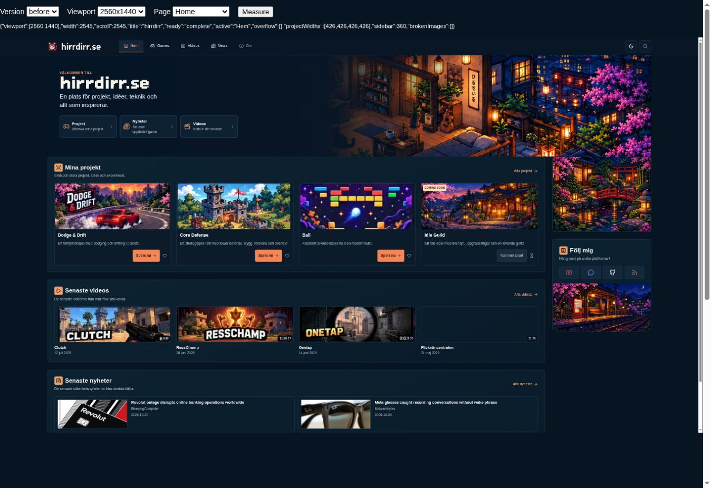
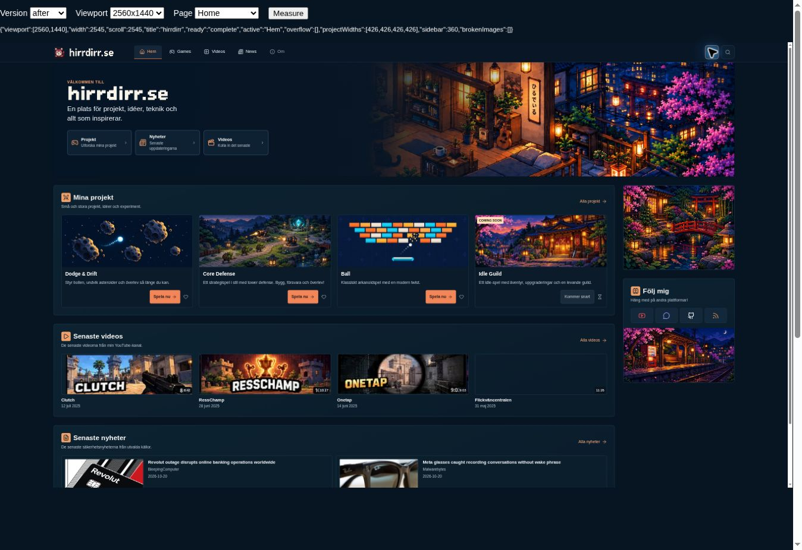
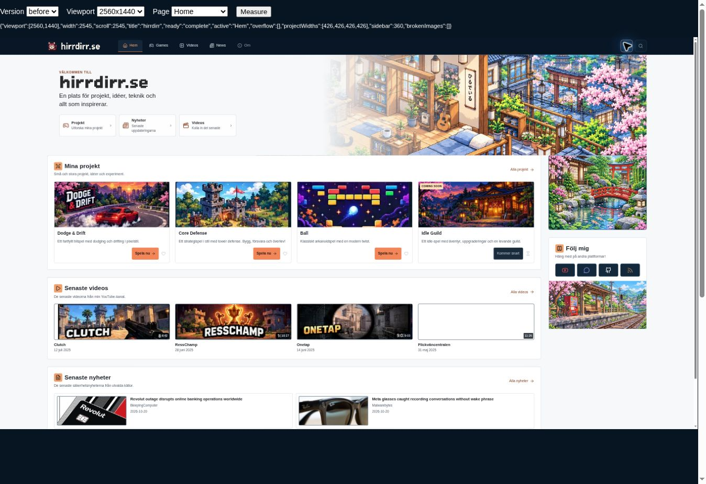
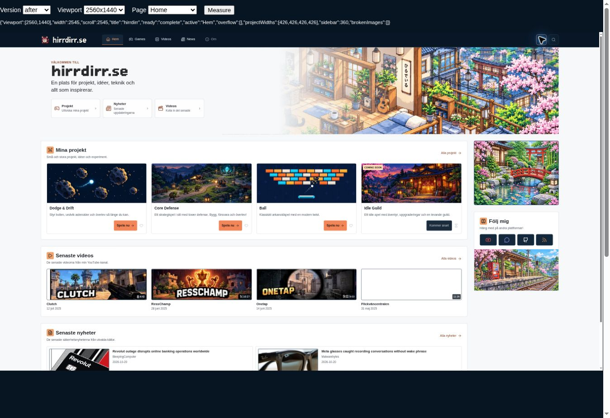
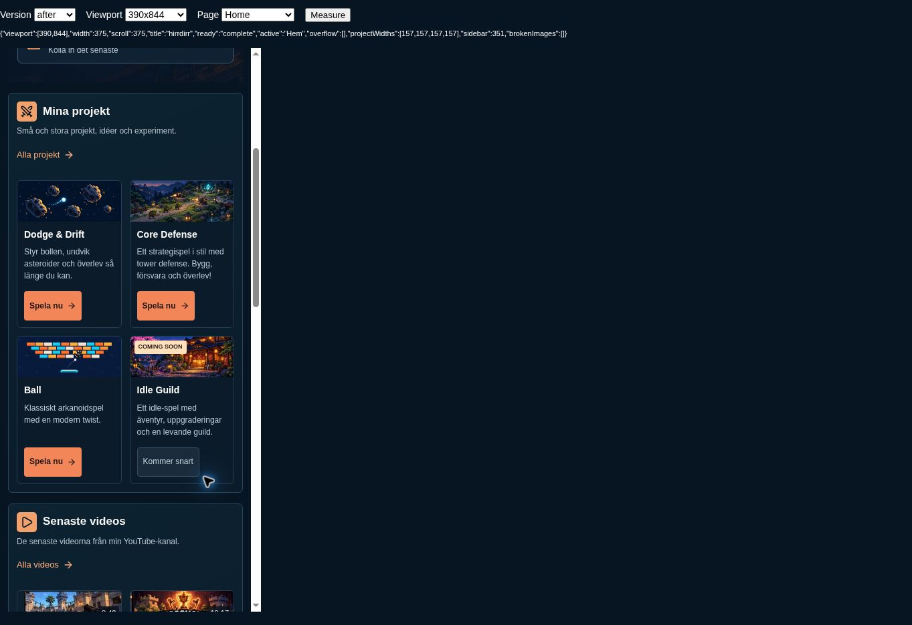
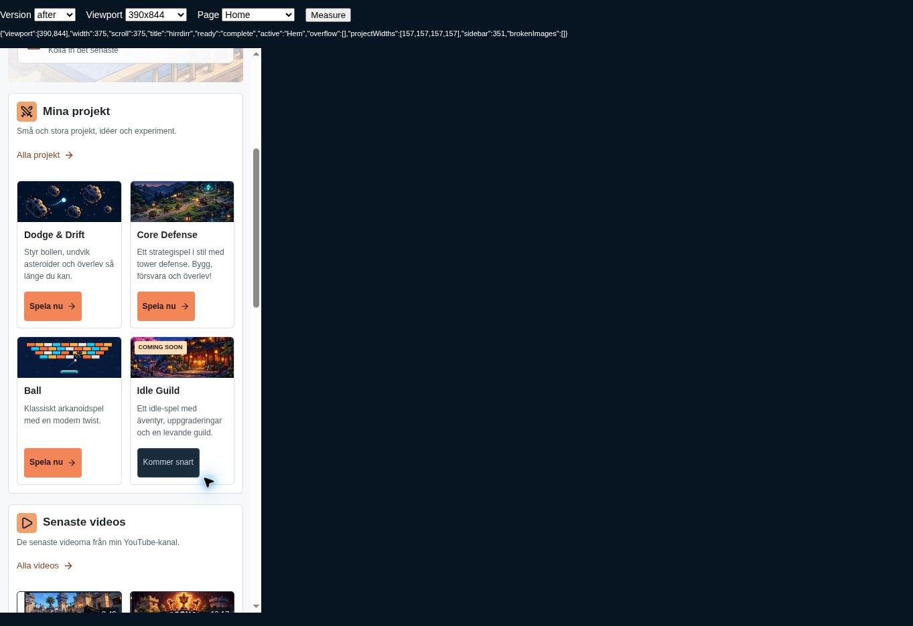

# Homepage artwork separation and game illustrations

Baseline: main at `93ce47f`, after the day/night artwork PR was merged.

## Changes

- The hero previously touched the content row and garden image with **0px** clearance. Its bottom margin now reuses `--site-gap`: 28px at 2560, 24px at 1920, about 17px at 1366, and 16px at 1280/tablet/mobile. A 6px corner radius matches the surrounding cards.
- Replaced the first three project-card sprite crops with individual, text-free WebP illustrations. The shared 240:95 card ratio and centered cover framing remain.
- Dodge & Drift now shows its actual premise: a glowing ball dodging asteroids. Its inaccurate car-game description and accessible image label are corrected.
- Core Defense now shows cannon towers protecting an energy core against goblins, in the site's Japanese-inspired pixel-art style.
- Ball now shows a paddle, ball and breakable blocks in a cleaner arcade composition.
- Idle Guild, its separate Coming Soon badge, the existing day/night scenes and theme switching are retained. Links, other content, gameplay and workflows are unchanged.

## Production assets

| Asset | Dimensions | Bytes |
| --- | --- | --- |
| `assets/artwork/home/dodge-drift.webp` | 1200×476 | 64908 |
| `assets/artwork/home/core-defense.webp` | 1200×475 | 270834 |
| `assets/artwork/home/ball.webp` | 1200×475 | 41788 |

Generated with the built-in imagegen tool. [prompts.md](prompts.md) records the complete prompt set. The old sprite file is retained to avoid deleting historical assets. No new JavaScript or dependencies.

## Validation

Chromium checked both themes at 2560×1440, 1920×1080, 1366×768, 1280×720, 768×1024 and 390×844. [validation.json](validation.json) records the measured gaps, consistent card ratios, lack of horizontal overflow, and unchanged inert Idle Guild card with its Coming Soon label.

Visually checked desktop and mobile artwork in both themes. Confirmed the three computed CSS image URLs, valid/nonempty WebP files, retained links and image descriptions. Source diff contains no game or theme-script changes. `git diff --check` passes.

The QA preview uses LiquidJS/Markdown because Ruby/Jekyll is unavailable; no production Jekyll build was run. The pre-existing missing external Flickväncentralen thumbnail is outside this update. Screenshots show real CSS viewports scaled to fit the review browser (desktop 2560×1440 and mobile 390×844); screenshot pixel dimensions differ from viewport dimensions. The `_review` folder is excluded from normal Jekyll publication.

## Screenshots

| Dark before | Dark after |
| --- | --- |
|  |  |

| Light before | Light after |
| --- | --- |
|  |  |

| Mobile dark | Mobile light |
| --- | --- |
|  |  |
