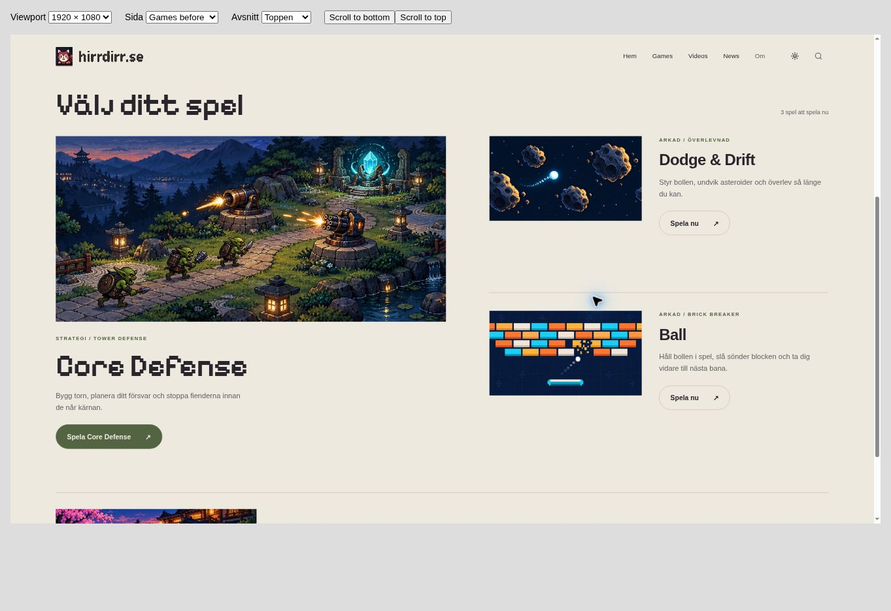
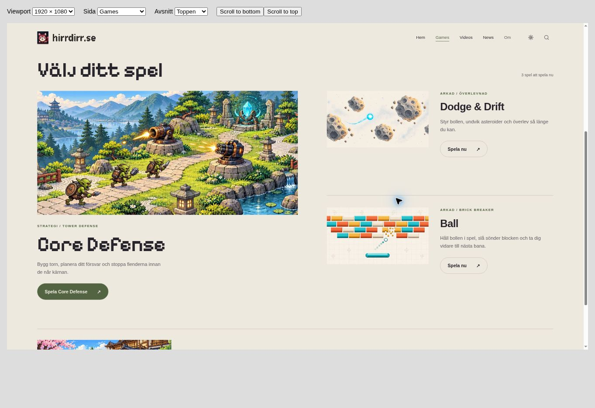
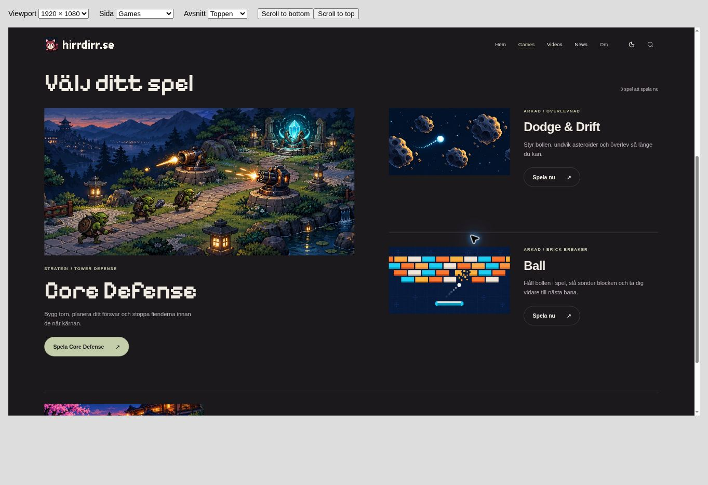
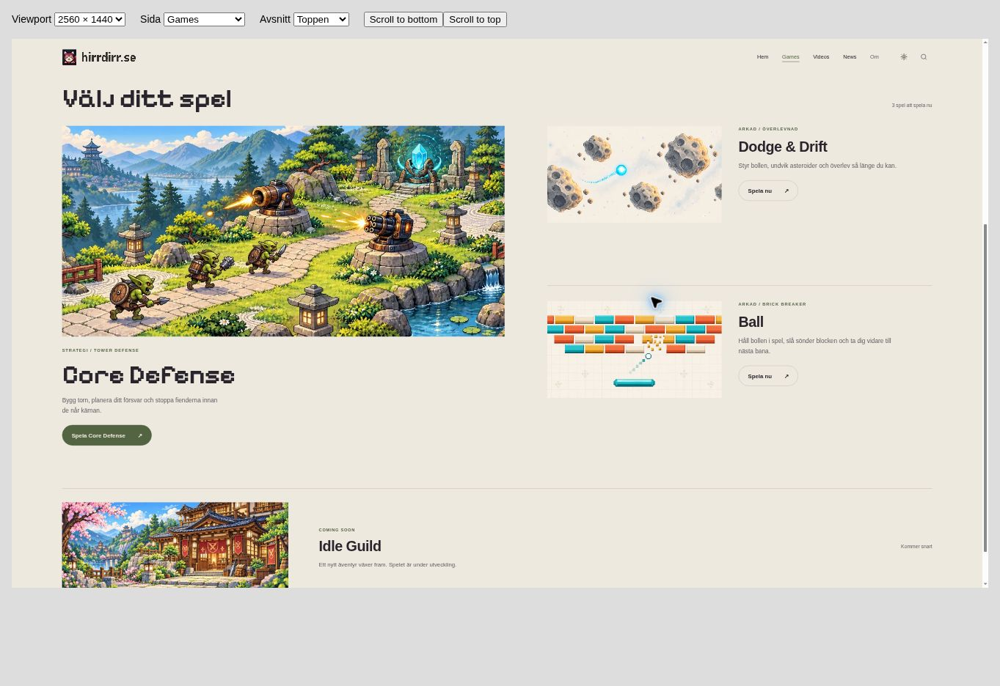
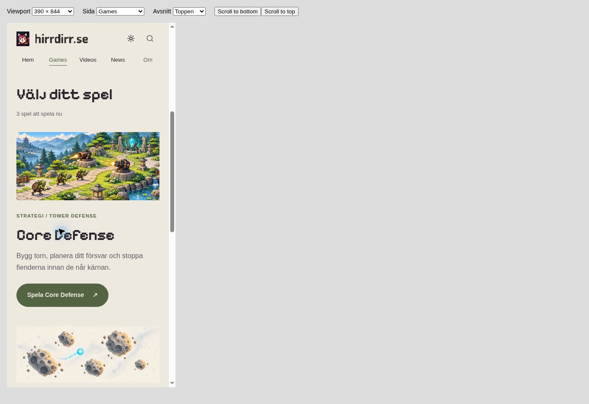
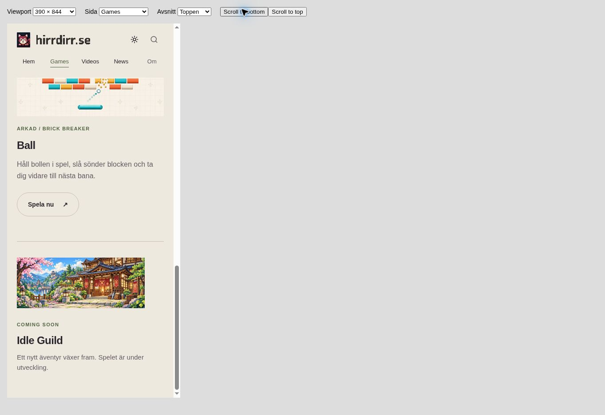
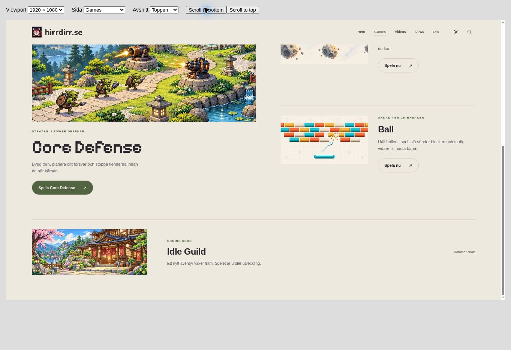

# Theme-aware game artwork

The four game illustrations on `/games/` now have dedicated light versions. The original dark artwork, page composition, game links and separate Idle Guild Coming Soon label are preserved. The homepage and actual games are outside this change.

## Assets

The light images were created with the built-in image-generation tool using each existing dark illustration as the edit target, then resized and encoded as WebP with ImageMagick. There is no brightness filter applied by the website.

| Game | Existing dark asset | New light asset | Light dimensions | Bytes |
| --- | --- | --- | --- | ---: |
| Core Defense | `assets/artwork/home/core-defense.webp` | `assets/artwork/home/core-defense-light.webp` | 1200×475 | 175086 |
| Dodge & Drift | `assets/artwork/home/dodge-drift.webp` | `assets/artwork/home/dodge-drift-light.webp` | 1200×475 | 30026 |
| Ball | `assets/artwork/home/ball.webp` | `assets/artwork/home/ball-light.webp` | 1200×475 | 12074 |
| Idle Guild | `assets/artwork/home/idle-guild.webp` | `assets/artwork/home/idle-guild-light.webp` | 960×380 | 118668 |

## Implementation

`_includes/game_artwork.html` provides the paired asset URLs and retains each image's accessible description using `role="img"` and `aria-label`. The existing `body.light` class selects the background in `assets/sections.css`, following the same pattern as the section's environment artwork. The original responsive aspect ratios, widths and cropping remain in place. Only the active theme's background is selected, with no duplicate image elements or additional JavaScript.

The existing early theme-restoration script and theme button are unchanged. The four selected game backgrounds load with the page; the former lazy `` for Idle Guild is now a CSS background like the other three. All four light WebP assets total 335854 bytes (about 328 KiB).

## Validation — 2026-10-30

- Rendered Games in a real browser at 2560×1440, 1920×1080, 1366×768, 768×1024 and 390×844, in both themes (10 combinations).
- Every combination selects the expected four asset URLs, preserves accessible labels and has nonzero artwork dimensions and no horizontal overflow.
- Compared the artwork, copy, arcade entrance and upcoming-strip bounding boxes against the original page at all five sizes. Positions and dimensions remain unchanged within one pixel in both themes.
- Toggled light/dark repeatedly and navigated Home → Games with light mode saved: the light assets are restored.
- The game-section jump remains below the sticky header. Idle Guild has zero links and its visible Coming Soon label remains in place.
- Asset references resolve locally; existing dark images, homepage, game implementations, scripts, video/news data and workflows are unchanged. Existing Games links and descriptions are retained.
- `git diff --check` passes.

Raw browser evidence: [browser-checks.json](browser-checks.json).

The local preview uses the repository's Liquid templates/layouts/data through LiquidJS + marked. A native Jekyll/GitHub Pages production build was not available locally. Browser CSS viewports are scaled to the screenshot window, so screenshot pixel dimensions differ from the tested viewport. Screenshots show a local preview, not a published change.

## Screenshots

| Before: light theme with dark artwork | After: light artwork | Dark originals retained |
| --- | --- | --- |
|  |  |  |

| Mobile | Idle Guild |
| --- | --- |
|  |  |

The exact generation prompts are recorded in [prompts.md](prompts.md).
