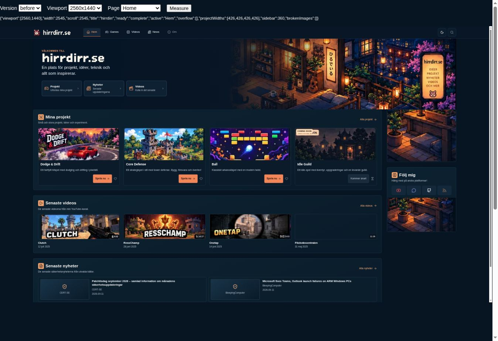
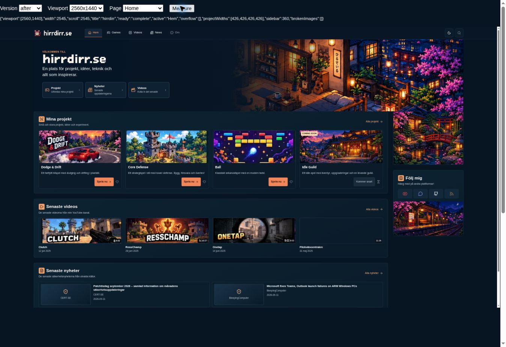
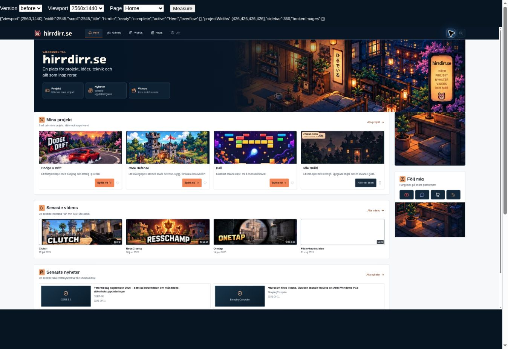
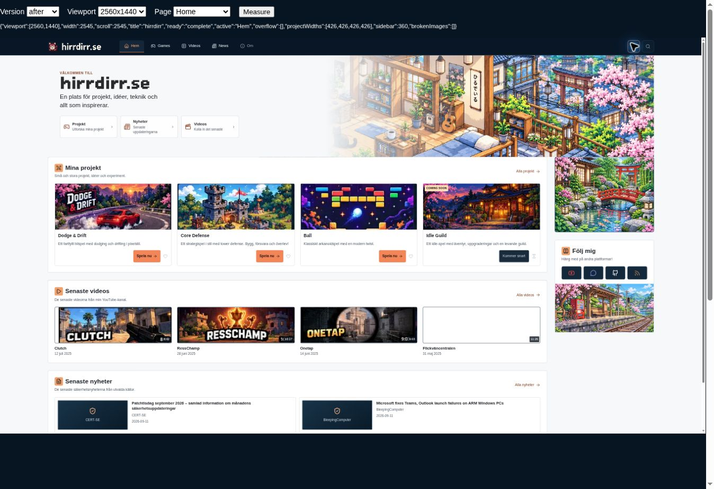
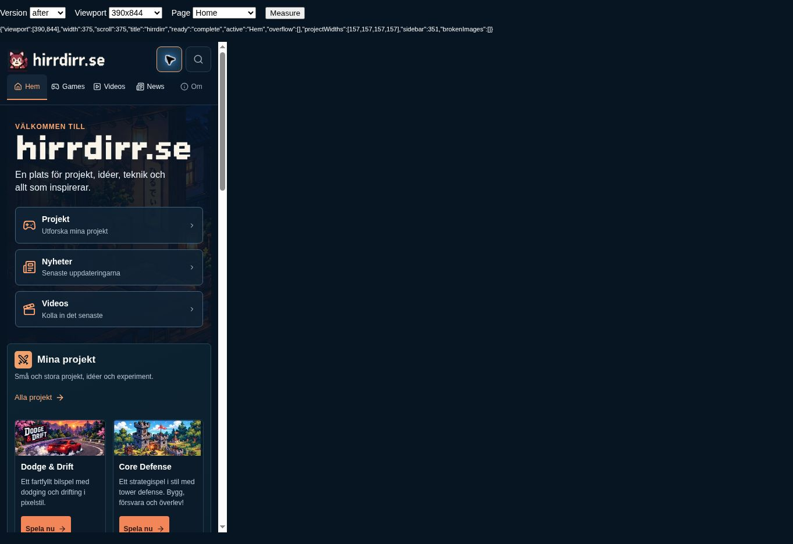
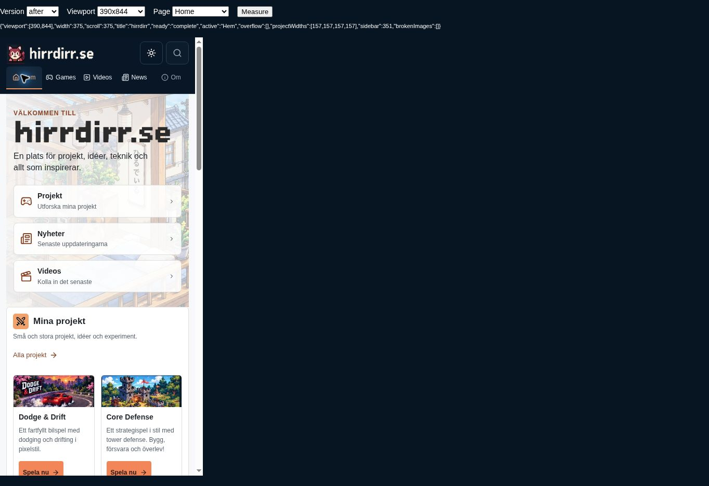
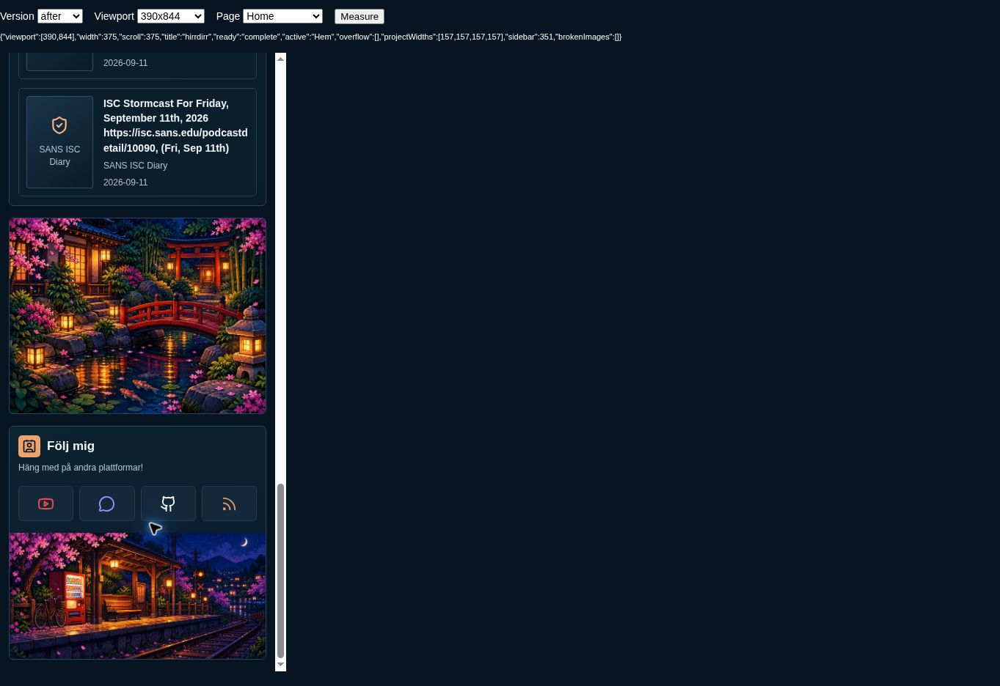
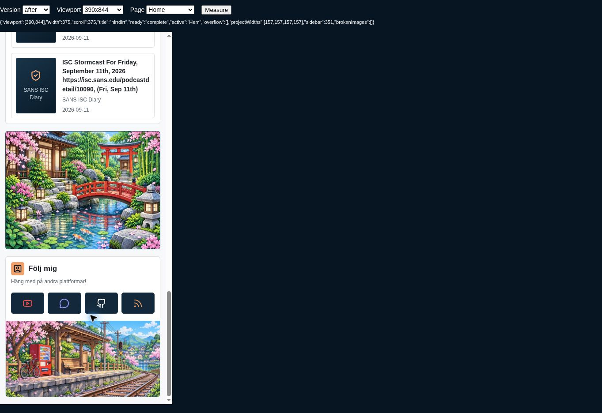

# Homepage artwork theme update

Baseline: main at `4392fcf` (the merged responsive-layout PR). This is an artwork update; homepage layout, spacing, typography, content order and functionality are retained.

## Inspected implementation

The hero used `assets/pixel-ref-hero.svg`. Both smaller sidebar areas used `assets/pixel-ref-side.svg` with different crops. These SVG files embed raster images; none had a light-theme counterpart. Idle Guild used the fourth cell of `pixel-ref-games.svg`, including embedded “COMING SOON” text, beneath a separate HTML badge. The existing theme button toggles `body.light` and saves `hirrdirr_theme` in localStorage.

## Assets

All new production files are under `assets/artwork/home/`:

| Area | Dark asset | Light asset | Change |
|---|---|---|---|
| Main banner | `hero-dark.webp` | `hero-light.webp` | Edited the existing room/balcony scene to remove the large outdoor marketing sign; added a separately painted daytime counterpart. The small indoor Japanese wall decoration remains. |
| Upper sidebar | `garden-dark.webp` | `garden-light.webp` | New courtyard, bridge and koi pond, with matching night/day compositions. |
| Below social icons | `station-dark.webp` | `station-light.webp` | New neighborhood railway stop, with matching night/day compositions. |
| Idle Guild card | `idle-guild.webp` | Same asset | New Japanese fantasy guild hall without lettering or an embedded status badge. |

Hero files are 2048px wide; sidebar files are 720px wide; Idle Guild is 960×380. WebP exports use proportional resampling where needed and quality 90. The three other project illustrations, video thumbnails, pixel wordmarks and original SVG assets are unchanged. Retained originals support historical references and avoid unrelated deletions.

The built-in imagegen tool created/edited the artwork; [prompts.md](prompts.md) records the prompt set. No API/CLI generation fallback or new runtime dependency was used.

## Theme behavior

- `--home-hero`, `--home-garden` and `--home-station` select night URLs by default and day URLs under `body.light`. The existing theme button and persistence code remain unchanged.
- A short `_includes/theme_init.html` restores a saved light preference immediately after the body opens, before artwork elements are parsed. Blocked storage safely keeps the existing dark default. This avoids initially presenting dark artwork to returning light-theme users.
- The light hero uses the existing light palette for its overlay, copy and quicklinks. Its existing bitmap wordmark is tinted dark for contrast; font shapes and geometry are unchanged. Mobile retains an appropriate readability overlay.
- Idle Guild's separate `COMING SOON` badge and `Kommer snart` status remain. The card still has no link, button or tab stop. Its artwork is independent of the old sprite strip.
- Accessible image descriptions now match the garden and guild hall and remain accurate in either theme.

## Validation

Chromium rendered Home in both themes at 2560×1440, 1920×1080, 1366×768, 1280×720, 768×1024 and 390×844. All 11 measured layout elements have the same position and dimensions before/after, rounded to 0.01 CSS px. No horizontal page overflow was found. [validation.json](validation.json) records the results.

Visually checked all seven assets in their real placements, the banner sign removal, the two distinct sidebar scenes and the text-free Idle Guild picture. Verified theme switching, saved light theme after navigation/reload, visible HTML badge and non-clickable Idle Guild card. All seven image references resolve to valid, nonempty WebP files; inline bootstrap syntax and `git diff --check` pass.

Previews use LiquidJS/Markdown rendering because Ruby/Jekyll is not installed here; a production Jekyll build was not run. The new template is a normal Jekyll include. No gameplay files, digest data/scripts or workflows are changed, so game-balance tests were not rerun for this artwork-only task. The pre-existing unavailable external Flickväncentralen thumbnail is outside this change.

## Screenshots

Desktop screenshots show the 2560×1440 CSS layout viewport scaled to fit the review browser. Screenshot pixel dimensions are not the tested viewport dimensions. Mobile captures use a 390×844 CSS viewport. The top controls identify each viewport. This underscore-prefixed review folder is excluded from normal Jekyll publication.

| Dark before | Dark after |
|---|---|
|  |  |

| Light before | Light after |
|---|---|
|  |  |

| Mobile dark | Mobile light |
|---|---|
|  |  |

| Mobile sidebar dark | Mobile sidebar light |
|---|---|
|  |  |
