# Open design for Games, Videos and News

The three section pages now use the homepage's plum/charcoal canvas, sage accents, warm light theme and unframed artwork. Their existing content, structure and distinct page compositions remain in place.

- **Games:** arcade entrance, Core Defense feature, Dodge & Drift / Ball side picks and the non-clickable Idle Guild upcoming strip. Remove enclosing panels, give artwork and copy space, and use rounded play buttons.
- **Videos:** studio portrait beside the featured player, followed by the existing numbered clip list. Keep real thumbnails, YouTube links and click-to-load privacy-enhanced embeds.
- **News:** monitoring-room masthead, edition navigation, publisher-grouped digest and highlights/archive rail. Keep readable source sections and the existing empty-source messages.

The six existing section WebP assets are reused. Dark/light switching still follows `body.light` and the existing persisted preference; no JavaScript, artwork bytes, content, data sources, URLs, gameplay or workflows changed.

## Code organization

`assets/open-shell.css` contains the existing homepage palette and navigation styles shared by the homepage and these three section pages. `open-home.css` retains homepage-specific composition rules and aliases the shared color tokens. `sections.css` is updated in place rather than adding a competing override layer. The default layout loads the common stylesheet only on the homepage and the three section pages.

## Validation — 2026-10-24

- Browser-rendered checks at **2560×1440, 1920×1080, 1366×768, 768×1024 and 390×844**, on all three pages in both themes: **30 combinations**. No horizontal overflow, correct artwork variants, nonzero artwork dimensions and correct active navigation.
- Visually reviewed desktop, tablet and mobile compositions, both themes, plus the mobile game list, clip list and digest content.
- Clicked the Games, Videos and News in-page jump links: targets remain below the sticky header. The header remains visible when scrolling.
- Verified keyboard focus and Enter activation of a video play button; it creates the expected titled `youtube-nocookie.com` iframe and removes the poster controls. Full third-party video playback was not verified.
- Opened the news archive (204 existing edition links), followed its return link and opened the latest digest permalink. Theme selection persists between pages.
- Source checks confirm page content/templates, video/news data, images, game files, JavaScript and workflows remain unchanged. Idle Guild contains no links. All six artwork references exist.
- Compared the homepage before/after shared-CSS extraction at the same five sizes in both themes. Dimensions, positioning, colors, font sizes and padding of the body, header, branding, navigation, hero, content container, quicklinks, three sections and outro are identical in all **10 comparisons**.
- `git diff --check` passes.

Raw measurements: [browser-checks.json](browser-checks.json), [home-regression.json](home-regression.json).

The preview rendered the repository's Liquid templates, layouts and data using LiquidJS + marked. Native Jekyll/GitHub Pages build was not available locally. Browser CSS viewports were rendered in an iframe scaled to the capture window, so screenshot pixel dimensions differ from the tested CSS viewport. These images show the local preview, not a live deployment.

## Before / after (1920×1080 CSS viewport)

| Page | Before, dark | After, dark | After, light |
| --- | --- | --- | --- |
| Games | 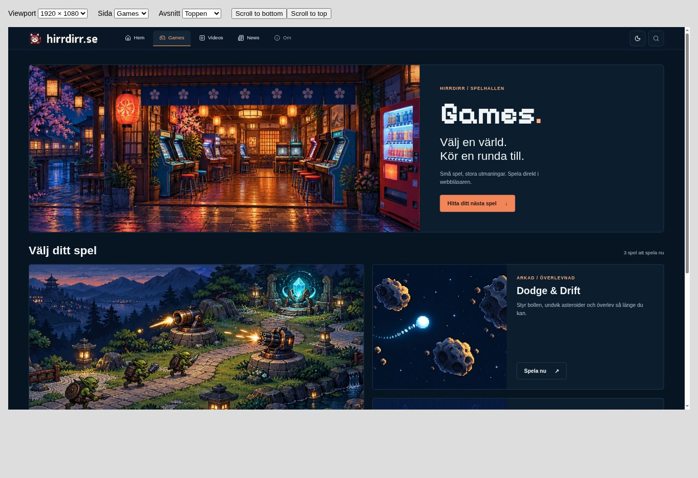 | 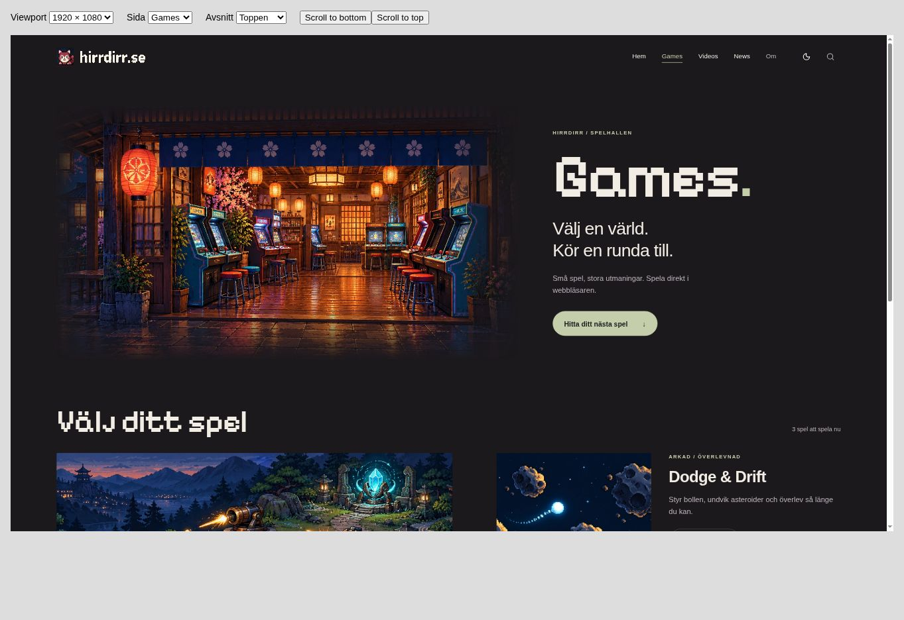 | 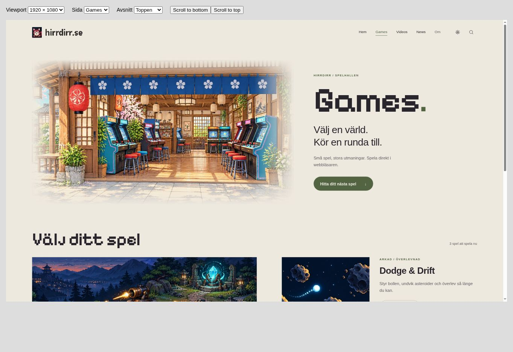 |
| Videos | 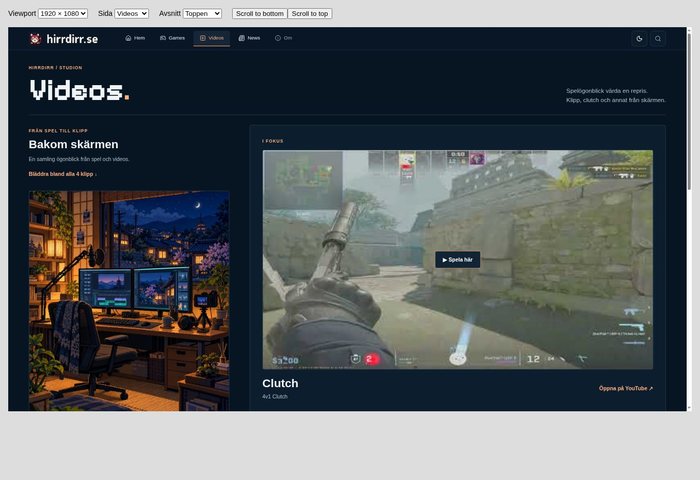 | 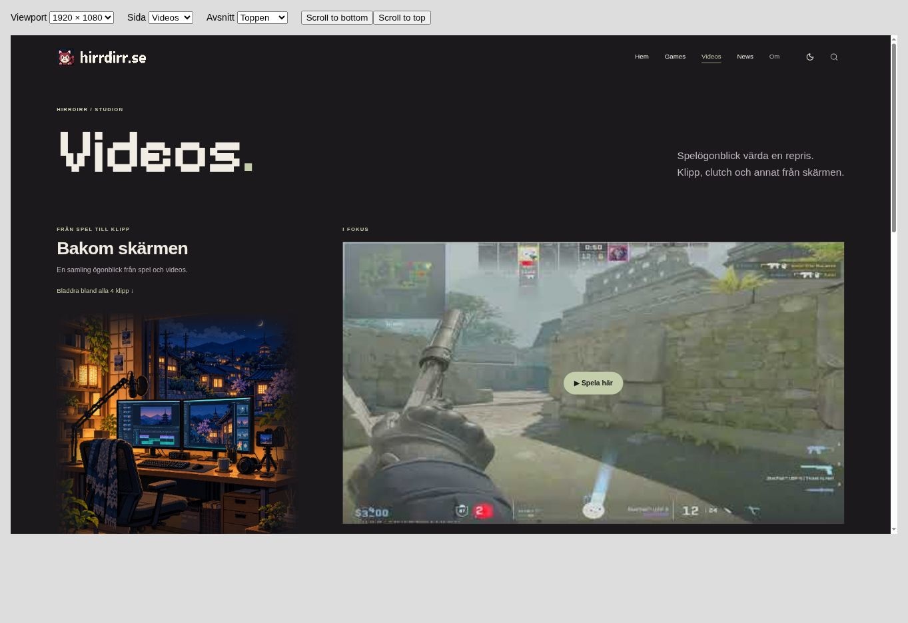 | 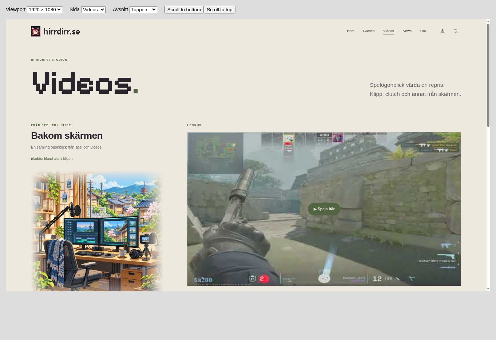 |
| News | 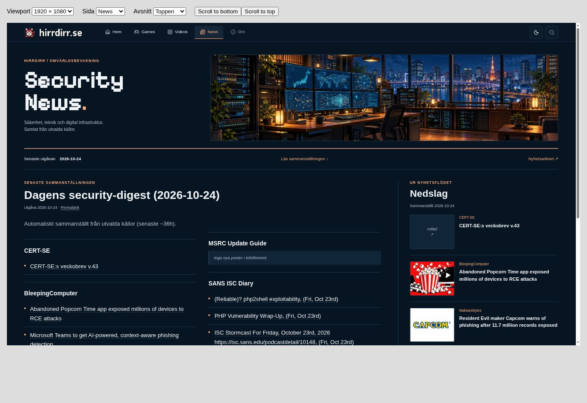 | 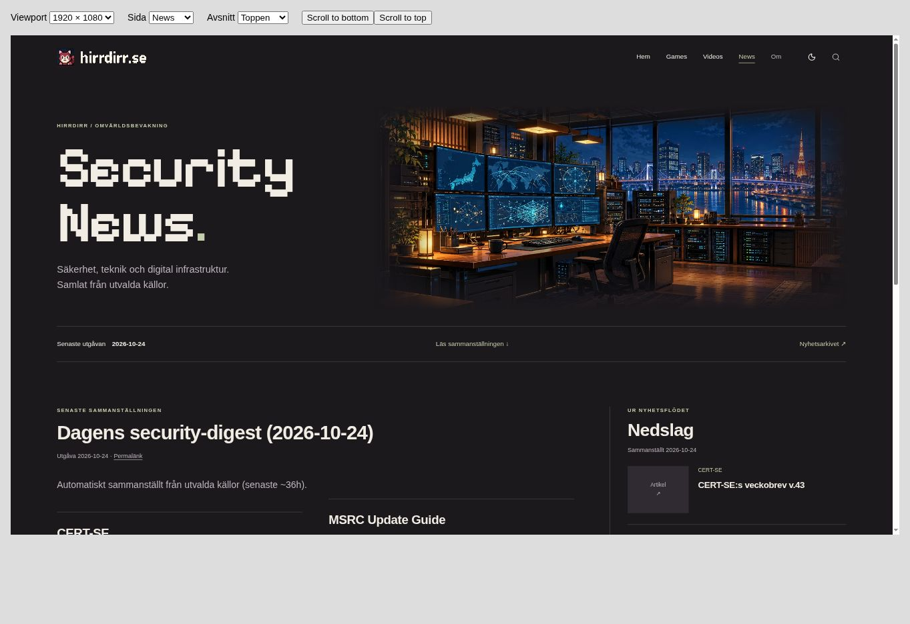 | 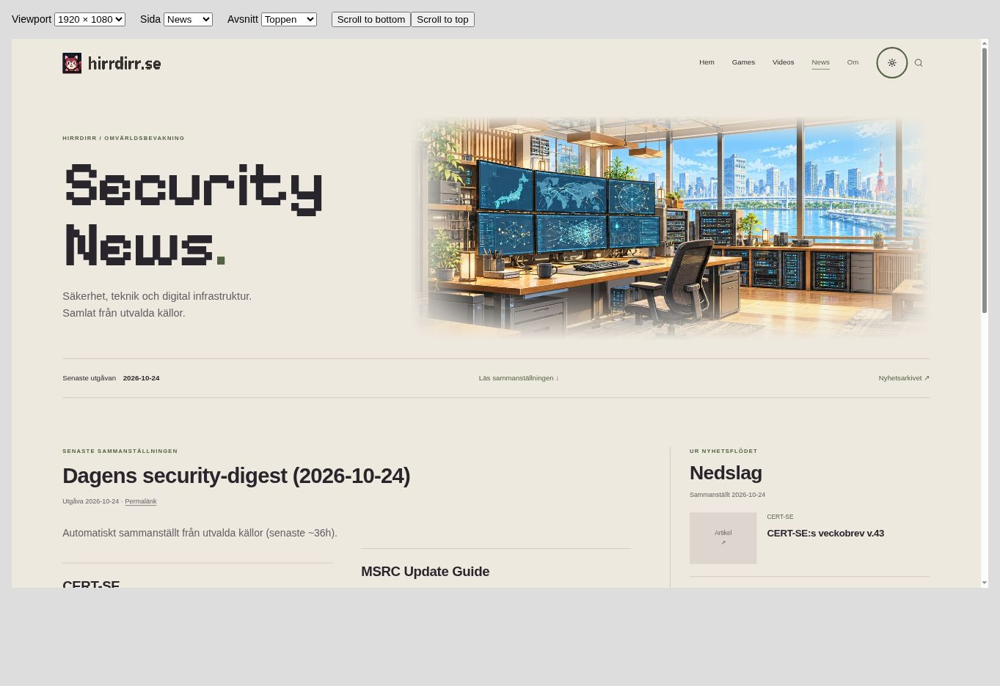 |

## Mobile (390×844 CSS viewport)

| Games | Videos | News |
| --- | --- | --- |
| 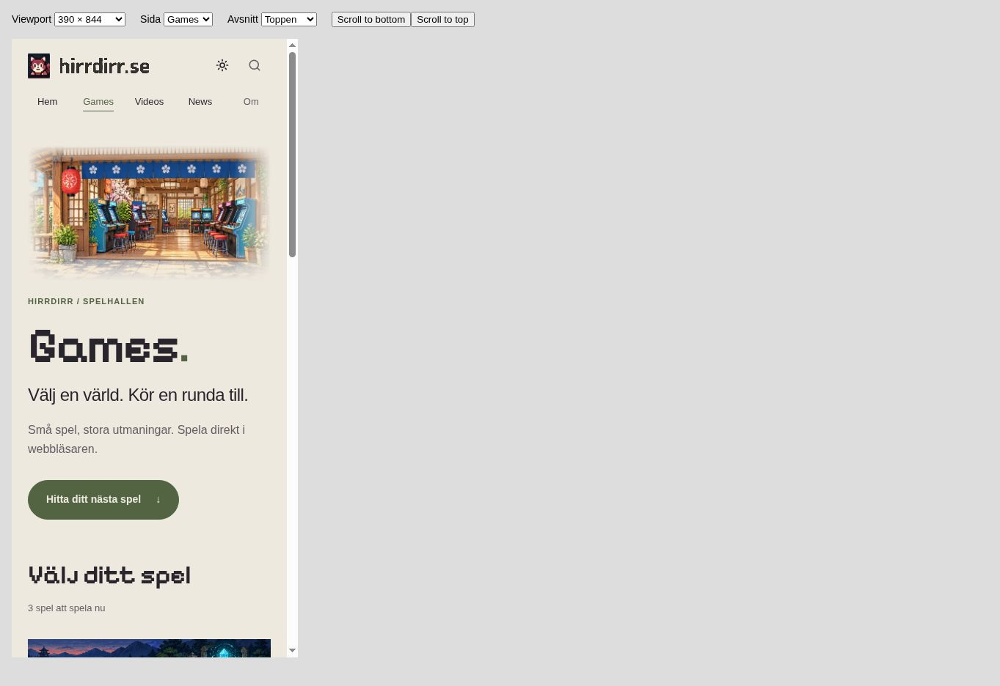 | 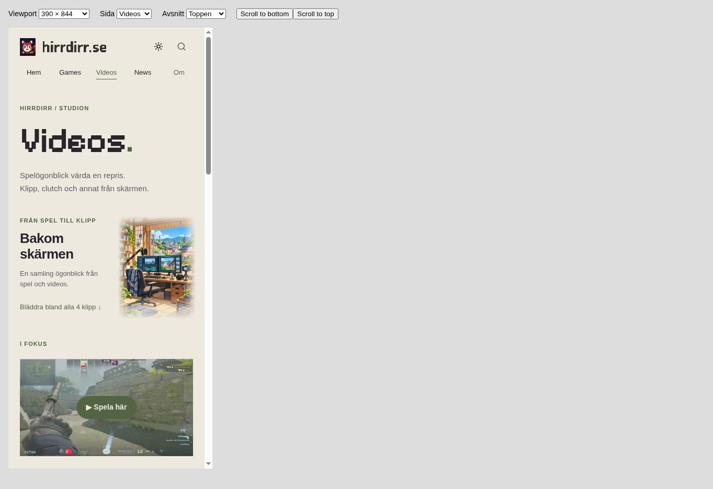 | 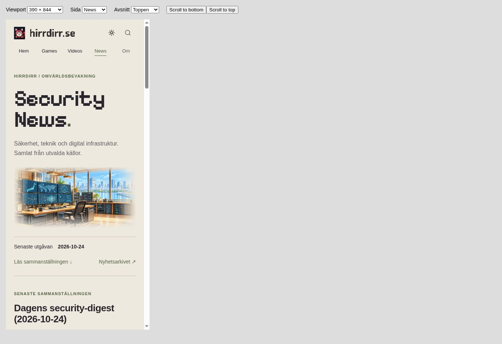 |
