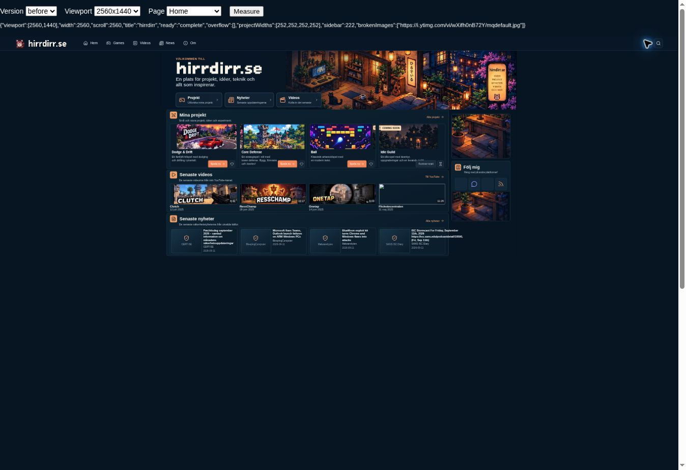
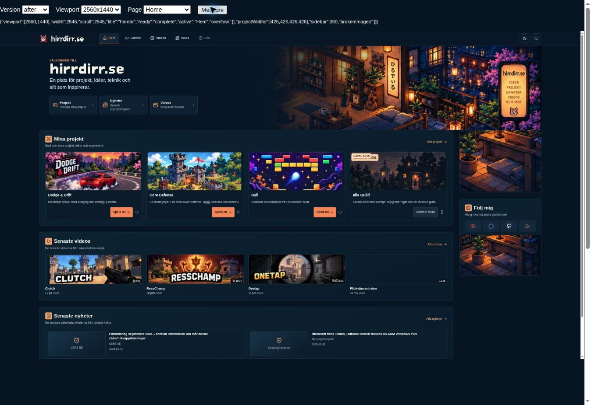
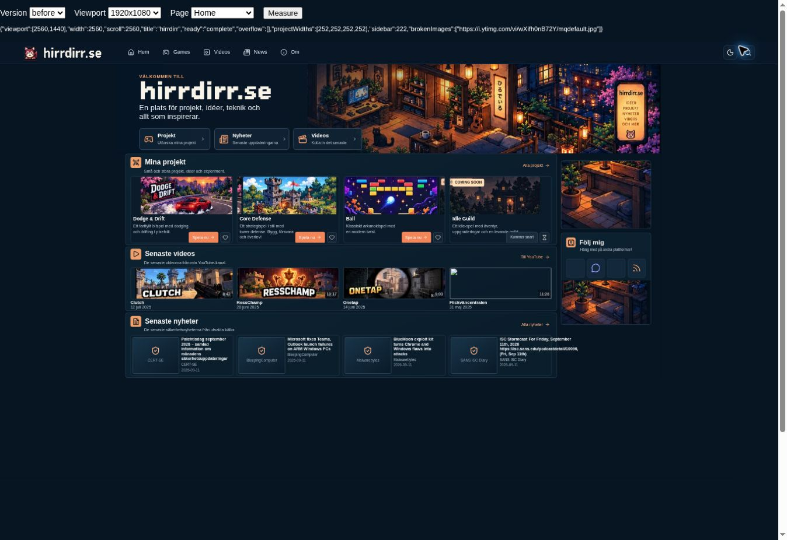
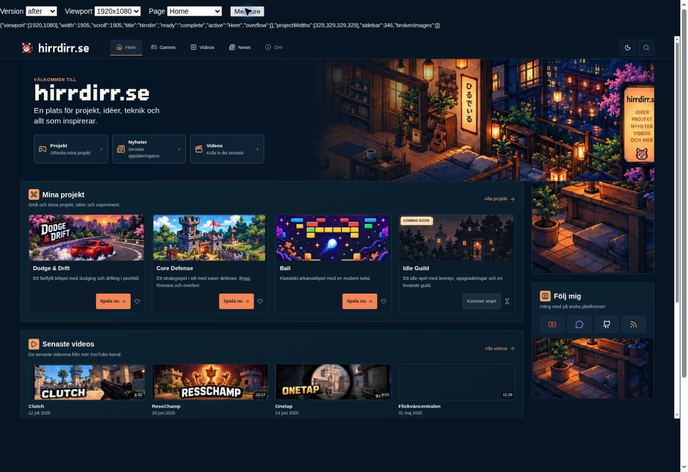
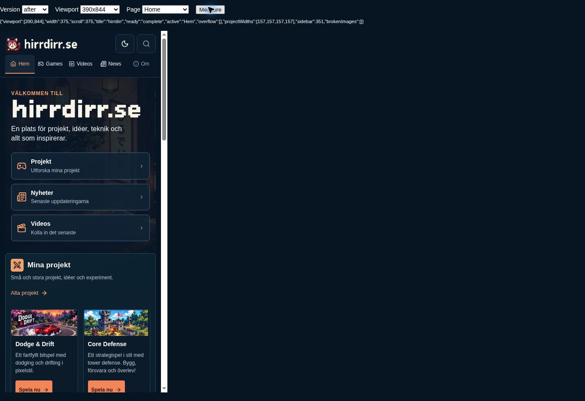

# Responsive layout review

Baseline: `d8a7e8e83513e4c2773d29e63ca66777b3c5b281`. Review date: 2026-10-19.

The existing artwork, wordmarks, section order, video IDs/titles and security data are preserved. No game rules, workflows, digest scripts or generated news data were changed. This underscore-prefixed review folder is excluded from normal Jekyll output.

## Findings and changes

- The homepage was capped at 1342px, with a fixed 222px sidebar and several successive CSS overrides. It now uses fluid gutters and up to 2200px of content, with a 260–360px sidebar that moves below the content on tablets.
- Fixed-height project cards and absolutely positioned controls could collide with text. Cards now use natural height, proportional artwork and aligned actions. News cards use readable two-column/one-column layouts.
- The shared 1100px container and 420px minimum grid cells wasted desktop space and overflowed on mobile. Game/video grids now wrap within available width. Reading pages retain a sensible line length.
- Header links now wrap on small screens and show the active section, including individual game/news pages. Added visible keyboard focus, a working skip link and larger control targets. Theme preference persists, with dark as the initial theme; the existing light palette is used for reading surfaces.
- The post layout referenced by all digest posts was missing. Added a minimal post layout with the existing header and links back to News/archive.
- Header height is measured for game presentation. Dodge & Drift's short-screen overlay scrolls; Core Defense observes the current header. Simulation code is unchanged.
- Lucide is pinned to 1.59.0 and loads asynchronously. The previous YouTube/GitHub outlines are included locally with their license because the current icon bundle omits those brands. Other artwork is unchanged.
- The misleading “Till YouTube” link to `/videos/` now reads “Alla videos”. GitHub links to the verified repository owner. Idle Guild remains non-clickable on the homepage and Games listing.

## Browser validation

Chromium rendered the actual HTML/CSS/JS inside an iframe whose layout viewport was set to each requested size. The screenshot display is scaled to fit the review browser; PNG dimensions are **not** the target viewport dimensions. Controls at the top identify the rendered viewport. Before and after use the same rendering method.

| Viewport | Home, Games, Videos | News, archive, individual post | Individual game pages |
|---|---|---|---|
| 2560 × 1440 | No horizontal page overflow | No horizontal page overflow | No horizontal page overflow |
| 1920 × 1080 | No horizontal page overflow | No horizontal page overflow | No horizontal page overflow |
| 1366 × 768 | No horizontal page overflow | No horizontal page overflow | No horizontal page overflow |
| 1280 × 720 | No horizontal page overflow | No horizontal page overflow | No horizontal page overflow |
| 768 × 1024 | No horizontal page overflow | No horizontal page overflow | No horizontal page overflow |
| 390 × 844 | No horizontal page overflow | No horizontal page overflow | No horizontal page overflow |

Individual games checked: Dodge & Drift, Core Defense (menu and running UI), Ball and the existing direct Idle Guild page. Decorative ground layers in Idle Guild extend inside their clipped scene; they do not cause page scrolling.

- Clicked Home → Games → Videos → News → archive; active navigation and destinations matched.
- Verified theme changes persist across navigation, keyboard focus is visible, and the skip link moves focus to main content.
- Started Dodge & Drift and Ball; started Core Defense and its first wave. No high scores were submitted.
- All four YouTube embeds loaded their actual titles/player controls. Playback was attempted, but continuous video playback could not be confirmed in this environment.
- Checked 1,648 internal link occurrences in rendered pages: no missing local destinations. Checked 19 distinct external destinations from Home/Videos/latest News: 18 returned HTTP 200; CISA returned 403, so its availability is unverified. HTTP success alone does not establish playback/content availability. Historical external article links were not exhaustively checked.
- `npm test`: **93 passed, 0 failed**. `git diff --check`: clean.

### Build limitation

Ruby/Jekyll is unavailable in this environment. Browser previews used LiquidJS with Markdown rendering, not a production Jekyll build. Preview dependencies and path-prefix adaptations are outside the repository and are not shipped. A real GitHub Pages/Jekyll build remains a review check before merge.

## Existing gaps kept explicit

- No Om section or search implementation exists in the current source. Both controls are visibly inactive; no placeholder destinations or new content were invented.
- YouTube/Discord social links and an RSS feed are not configured in the source. Those icons remain non-links with descriptive labels. GitHub is connected.
- The existing Flickväncentralen thumbnail failed to load in this browser. Its original source is retained, and a failed image no longer displays a broken-image glyph. The video link and embed remain intact.
- Homepage video dates/durations are existing hardcoded presentation values, not verified metadata (for example, the Clutch embed reports 24 seconds). They were preserved to avoid an unsolicited content rewrite.

## Screenshots

### 2560 × 1440 layout viewport

| Before | After |
|---|---|
|  |  |

### 1920 × 1080 layout viewport

| Before | After |
|---|---|
|  |  |

### 390 × 844 layout viewport

