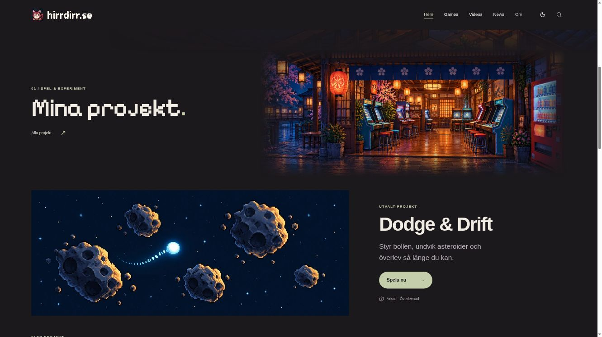
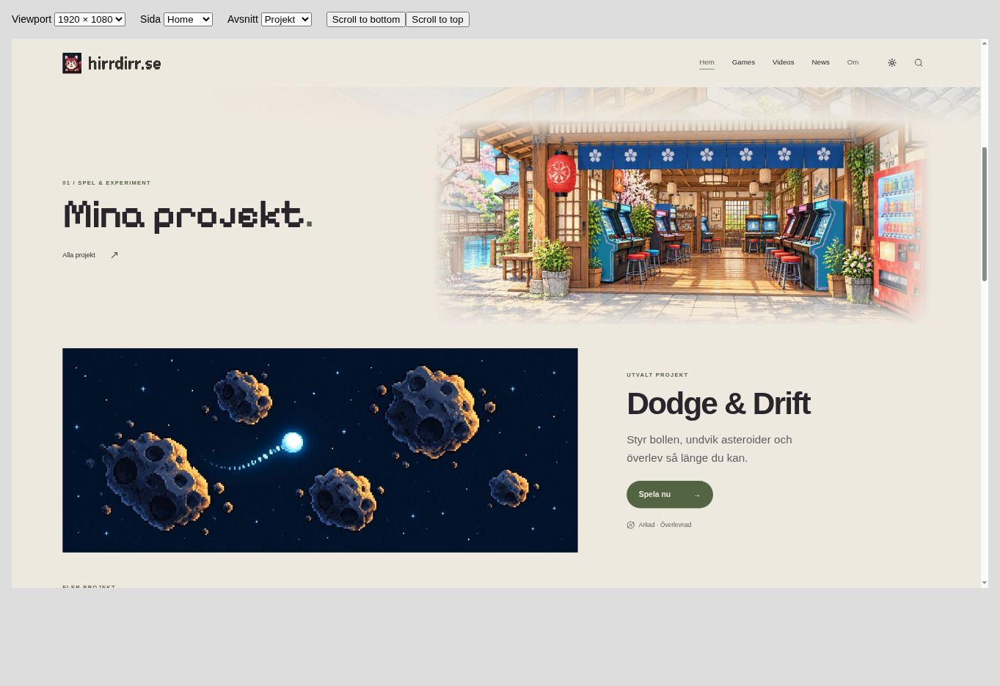
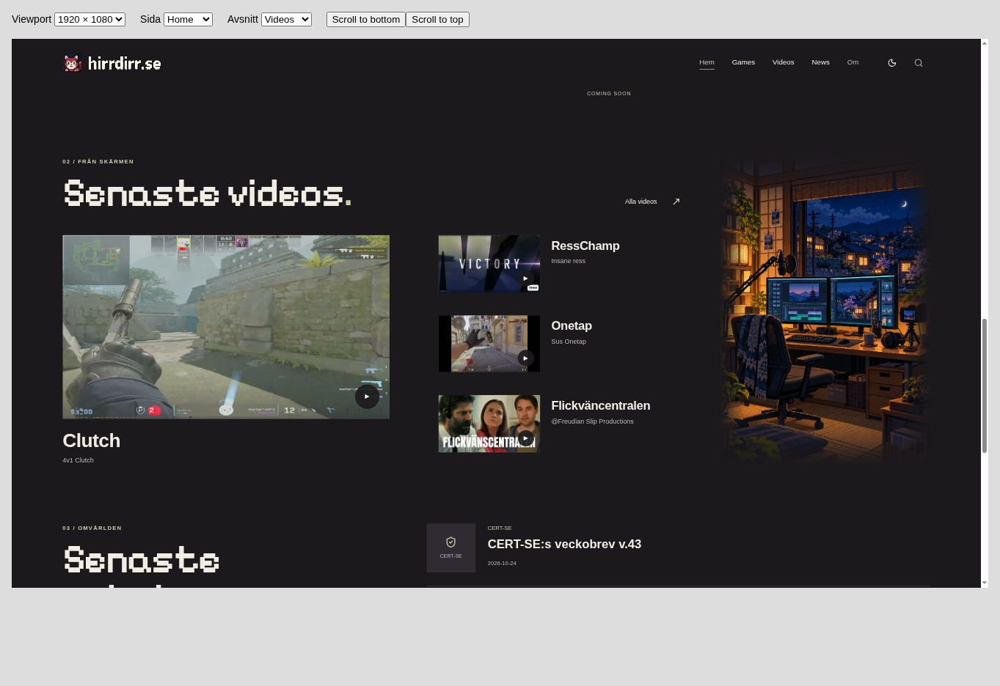
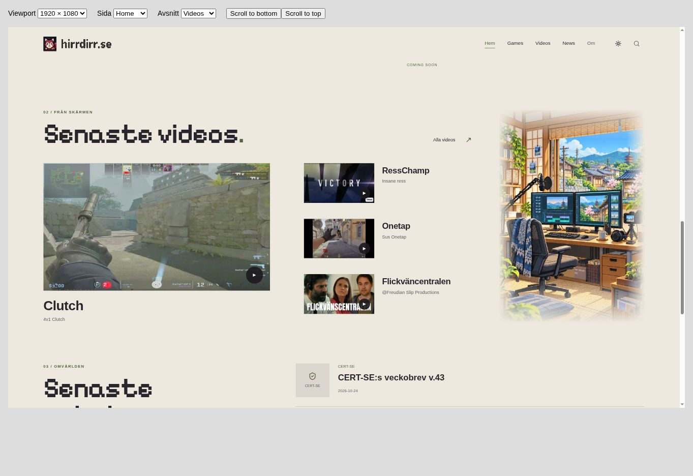
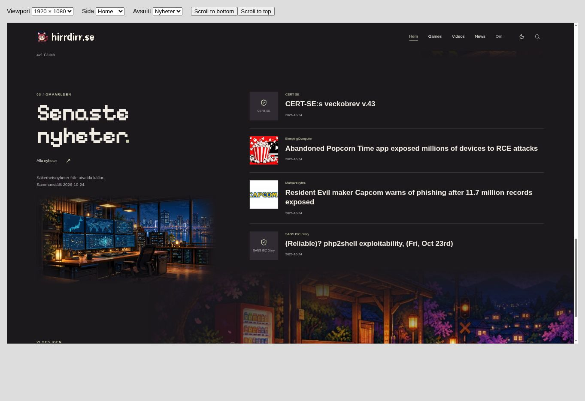
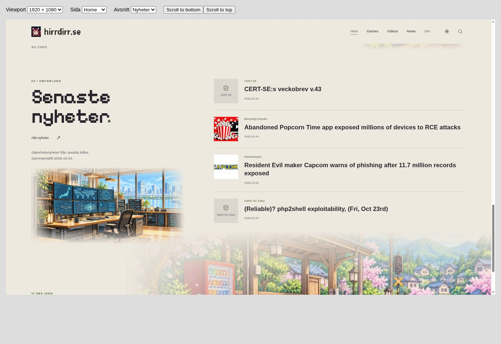
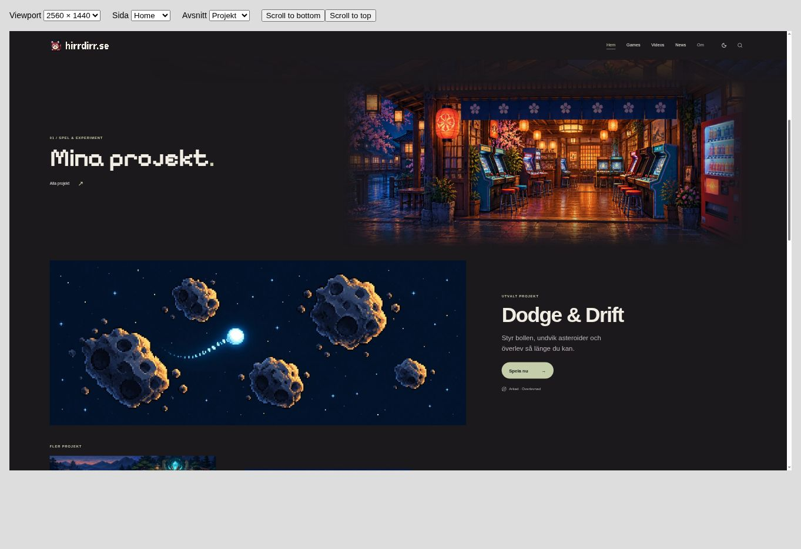
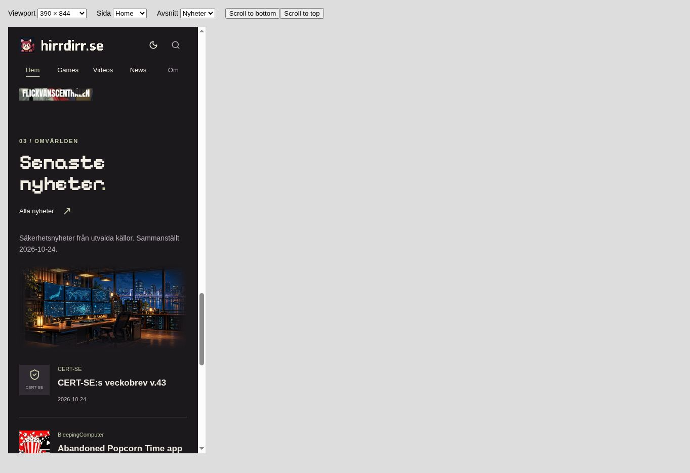
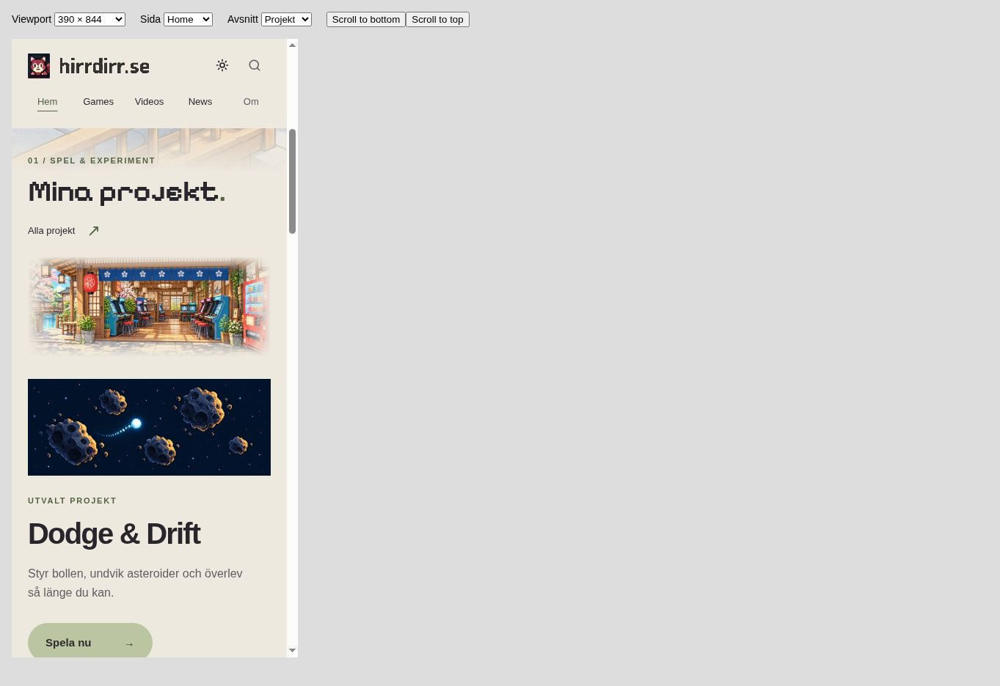

# Homepage section artwork

The sticky-navigation change in #50 did not include the requested homepage section artwork. This follow-up adds the existing Games arcade, Videos studio and News monitoring-room scenes to their corresponding homepage sections.

## Implementation

- Reuse `assets/artwork/sections/{games,videos,news}-{dark,light}.webp`; no copied or regenerated artwork.
- Homepage-scoped CSS variables follow the existing `body.light` theme state. The existing theme script and persistence remain unchanged.
- Place decorative, `aria-hidden` scenes outside text and thumbnail surfaces, with feathered edges matching the open homepage canvas.
- Put the arcade next to the project introduction on desktop and beneath it on mobile. Put the studio beside the video gallery on desktop and beside its heading on tablet/mobile. Put the newsroom beneath the news introduction.
- Replace the old garden decoration between projects and videos, and shorten the main hero's lower overflow to avoid crowding the new arcade scene. Preserve the main hero and footer station assets.
- Preserve content order, all existing links, video/news data, Coming Soon state and sticky navigation. No game, workflow, shared JavaScript or secondary-page changes.

## Validation — 2026-10-24

Browser-rendered checks at 2560×1440, 1920×1080, 1366×768, 768×1024 and 390×844, in both themes:

- No horizontal overflow; all three scenes have nonzero dimensions and select the correct theme assets.
- Sticky header stays at the top; homepage quicklinks still leave headings below it.
- All-projects, all-videos and all-news links reach the correct pages and retain the selected theme.
- Four real videos and four digest headlines remain present. Idle Guild has no link.
- Source comparison confirms every homepage `href` and image `src` is unchanged; all six background assets exist. `git diff --check` passes.

`browser-checks.json` records viewport/theme measurements and navigation checks. Viewports were actual CSS viewport sizes inside a browser iframe, scaled to fit the capture window; screenshot pixel dimensions therefore differ from the CSS viewport dimensions. Screenshots show the local rendered preview, not a live deployment.

Preview limitation: the environment used the repository's Liquid templates, layouts and data through LiquidJS + marked; native Jekyll/GitHub Pages production build was not run. External article and YouTube playback were not re-tested; their URLs and integrations were not changed.

## Desktop screenshots (1920×1080 CSS viewport)

| Section | Dark | Light |
| --- | --- | --- |
| Projects |  |  |
| Videos |  |  |
| News |  |  |

## Other sizes

